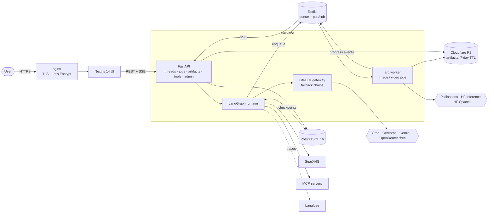
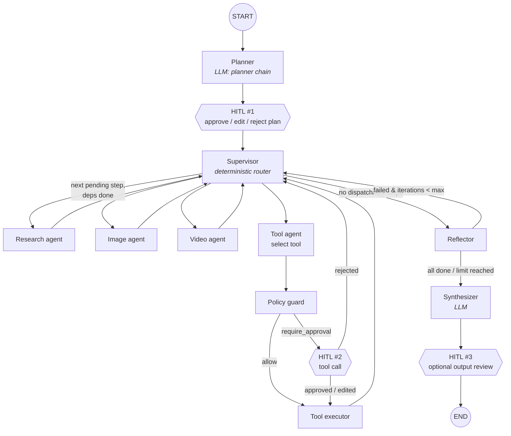
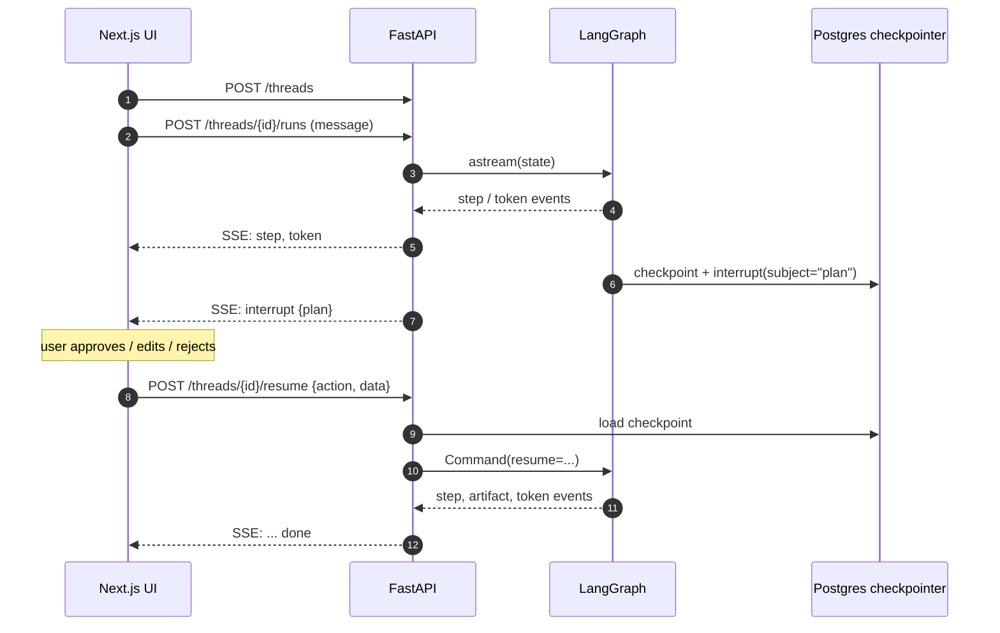
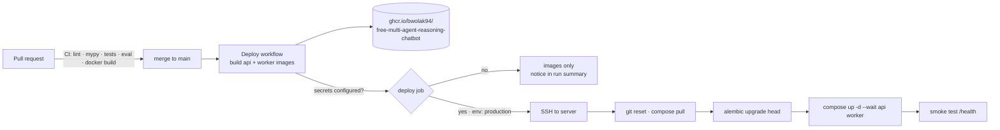

# Free Multi-Agent Reasoning Chatbot

[](https://github.com/bwolak94/Free-Multi-Agent-Reasoning-Chatbot/actions/workflows/ci.yml)
[](https://github.com/bwolak94/Free-Multi-Agent-Reasoning-Chatbot/actions/workflows/deploy.yml)
[](https://github.com/bwolak94/Free-Multi-Agent-Reasoning-Chatbot/actions/workflows/security.yml)
[](https://www.python.org/downloads/)
[](https://nextjs.org/)
[](./LICENSE)
[](https://github.com/astral-sh/ruff)

A self-hostable, **$0-inference** multi-agent reasoning chatbot. A LangGraph planner breaks the request into steps, a deterministic supervisor dispatches them to specialist agents (research, image, video, tools/MCP), a reflector retries failures, and a synthesizer writes the final answer — with **human-in-the-loop (HITL)** approval gates at plan, tool-call and output level, and threads that survive restarts.

All LLM calls go through a LiteLLM gateway with fallback chains over free tiers (Groq, Cerebras, Gemini, OpenRouter `:free`). Production runs on a single Hetzner VM with Docker Compose and Cloudflare R2 for artifacts.

---

## Table of contents

- [Key features](#key-features)
- [Architecture](#architecture)
- [Agent graph](#agent-graph)
- [HITL flow](#human-in-the-loop-flow)
- [Tech stack](#tech-stack)
- [Quick start](#quick-start-local-dev)
- [Configuration](#configuration)
- [API](#api)
- [Deployment](#deployment)
- [Project structure](#project-structure)
- [Status](#status)

---

## Key features

| Feature | Description |
|---|---|
| Plan → Execute → Reflect | Structured plan with step dependencies; failed steps are retried up to `MAX_ITERATIONS` |
| Specialist agents | Research (SearXNG + extraction + citations), Image (Pollinations / HF Inference), Video (HF Spaces), Tool (registry + MCP) |
| Human-in-the-loop | Approve / edit / reject the plan (HITL #1), high-risk tool calls (HITL #2), final output (HITL #3) |
| $0 LLM cost | Fallback chains across Groq, Cerebras, Gemini free tier and OpenRouter `:free` |
| MCP extensibility | Plug in MCP servers via `config/mcp.yaml` — no code changes |
| Policy engine | Deterministic YAML rules (`deny`, `require_approval`, prompt rules), hot-reloaded via `POST /admin/reload` |
| Durable threads | LangGraph Postgres checkpointer — interrupts persist indefinitely, runs resume after restarts |
| Async jobs | Long-running image/video generation on a Redis + arq worker with SSE progress |
| Observability | Langfuse tracing via OpenTelemetry, structured logs, eval suite with a FakeLLM |

---

## Architecture



---

## Agent graph

The supervisor and reflector are **deterministic** (no LLM call) — only the planner, agents and synthesizer use models.



---

## Human-in-the-loop flow



---

## Tech stack

| Layer | Technology |
|---|---|
| API | FastAPI, sse-starlette, Pydantic v2 |
| Orchestration | LangGraph (interrupt/resume, `Command` routing, Postgres / SQLite checkpointer) |
| LLM gateway | LiteLLM — `planner` and `fast` model groups with fallbacks |
| LLMs | Groq · Cerebras · Gemini free tier · OpenRouter `:free` |
| Search | SearXNG (self-hosted), Tavily fallback, trafilatura extraction |
| Image / video | Pollinations API · HF Inference · HF Spaces via `gradio_client` |
| Queue | Redis 7 + arq |
| Persistence | PostgreSQL 16, SQLAlchemy 2 (async), Alembic |
| Artifacts | Cloudflare R2 (S3 API via aioboto3), local FS in dev |
| Observability | Langfuse (self-hosted) · OpenTelemetry · structlog |
| Frontend | Next.js 14 (App Router, TypeScript, Tailwind) |
| Infra | Docker Compose, nginx + Certbot, Hetzner Cloud, GHCR |
| Quality | ruff, mypy, pytest (+ eval suite), Trivy, Gitleaks, CodeQL |

---

## Quick start (local dev)

**Prerequisites:** Python 3.12, [uv](https://docs.astral.sh/uv/), Docker + Compose plugin, Node 20 (UI), free API keys for Groq, Gemini, OpenRouter and Hugging Face.

```bash
# 1. Clone and install
git clone https://github.com/bwolak94/Free-Multi-Agent-Reasoning-Chatbot.git
cd Free-Multi-Agent-Reasoning-Chatbot
uv sync

# 2. Configure environment
cp .env.example .env          # add GROQ_API_KEY, GEMINI_API_KEY, OPENROUTER_API_KEY, HF_TOKEN

# 3. Start infrastructure (Postgres, Redis, SearXNG, Langfuse)
make infra

# 4. Run migrations
make migrate

# 5. Start API + worker (hot reload)
make dev

# 6. (optional) Start the chat UI
cd frontend && npm install && cd .. && make ui
```

| Service | URL |
|---|---|
| API / OpenAPI docs | http://localhost:8000 · http://localhost:8000/docs |
| Chat UI | http://localhost:3000 (`make ui`) or :3001 via `docker compose --profile frontend up` |
| Langfuse | http://localhost:3000 (when running in Docker; pick a different port for the UI) |
| SearXNG | http://localhost:8080 |

Without Docker you can set `USE_SQLITE=true` and `USE_LOCAL_FS=true`.

### Tests and checks

```bash
make check      # ruff format/lint + mypy
make test       # pytest (recorded fixtures, no live API calls)
make test-cov   # with coverage report
make eval       # eval suite (FakeLLM, 6 canonical scenarios)
```

---

## Configuration

| File | Purpose |
|---|---|
| `.env` | Secrets and runtime flags (see `.env.example`, `.env.prod.example`) |
| `config/litellm_config.yaml` | Model groups and fallback chains |
| `config/agents.yaml` | Agent registry and their tools |
| `config/rules/default.yaml` | Prompt rules and policy rules (hot-reloadable) |
| `config/mcp.yaml` | MCP servers (stdio / http) |

| Variable | Description | Required |
|---|---|---|
| `GROQ_API_KEY` | [console.groq.com](https://console.groq.com) | Yes |
| `GEMINI_API_KEY` | [aistudio.google.com](https://aistudio.google.com) | Yes |
| `OPENROUTER_API_KEY` | [openrouter.ai](https://openrouter.ai) | Yes |
| `HF_TOKEN` | [huggingface.co/settings/tokens](https://huggingface.co/settings/tokens) | Yes |
| `CEREBRAS_API_KEY` | Fast inference in the `fast` chain | Optional |
| `TAVILY_API_KEY` | Search fallback | Optional |
| `DATABASE_URL` / `USE_SQLITE` | Postgres DSN, or SQLite in dev | Yes |
| `REDIS_URL` | Redis DSN | Yes |
| `R2_ACCOUNT_ID`, `R2_ACCESS_KEY_ID`, `R2_SECRET_ACCESS_KEY`, `R2_BUCKET`, `R2_ENDPOINT` | Cloudflare R2 artifact storage | Prod |
| `USE_LOCAL_FS` | `true` = store artifacts on local disk | Dev |
| `HF_VIDEO_SPACE`, `HF_VIDEO_API_NAME` | HF Space used by the video agent | Optional |
| `LANGFUSE_HOST`, `LANGFUSE_PUBLIC_KEY`, `LANGFUSE_SECRET_KEY` | Tracing | Optional |
| `MAX_ITERATIONS`, `ARTIFACT_TTL_DAYS`, `LOG_LEVEL` | Runtime tuning | Optional |

---

## API

| Method | Path | Description |
|---|---|---|
| `GET` | `/health` | Liveness check → `{"status":"ok"}` |
| `POST` | `/threads` | Create a thread (with optional `hitl_config`) |
| `GET` | `/threads/{id}` | Thread status and HITL config |
| `POST` | `/threads/{id}/runs` | Start a run — **SSE** stream |
| `POST` | `/threads/{id}/resume` | Resume after an interrupt (`approve` / `edit` / `reject`) — **SSE** |
| `GET` | `/jobs/{job_id}/stream` | Worker job progress — **SSE** |
| `GET` | `/artifacts/{id}` | Artifact metadata, URL and expiry |
| `GET` | `/tools` | Registered tools (built-in + MCP) |
| `POST` | `/admin/reload` | Hot-reload rules and config |

SSE event types: `token`, `step`, `interrupt`, `artifact`, `progress`, `done`, `error` (see `frontend/types/events.ts`).

---

## Deployment

Production target: one Hetzner Cloud VM (e.g. CX32) running Docker Compose, nginx with Let's Encrypt, Cloudflare R2 for artifacts.



### One-time server setup

```bash
# on the server (Ubuntu 24.04, Docker installed)
git clone https://github.com/bwolak94/Free-Multi-Agent-Reasoning-Chatbot.git /opt/chatbot
cd /opt/chatbot
cp .env.prod.example .env       # fill in all values; GITHUB_REPOSITORY must be lowercase
DOMAIN=chat.example.com EMAIL=you@example.com make cert
make deploy
```

### GitHub configuration for CD

The deploy job runs only when these are set (otherwise the workflow just builds and pushes images):

| Type | Name | Value |
|---|---|---|
| Secret | `DEPLOY_HOST` | Server IP / hostname |
| Secret | `DEPLOY_SSH_KEY` | Private key of the deploy user |
| Secret | `DEPLOY_USER` | SSH user (optional, default `root`) |
| Variable | `DOMAIN` | Public domain, used for the smoke test and environment URL (optional) |
| Variable | `DEPLOY_PATH` | App directory on the server (optional, default `/opt/chatbot`) |

Add them under **Settings → Secrets and variables → Actions** (or on the `production` environment).

---

## Project structure

```
.
├── api/                    # FastAPI app
│   ├── main.py             # entrypoint, /health, router wiring
│   ├── routers/            # threads, jobs, artifacts, tools, admin
│   ├── llm.py              # LiteLLM gateway
│   ├── checkpointer.py     # Postgres / SQLite checkpointer
│   ├── config_manager.py   # rules + hot reload
│   ├── mcp_loader.py       # MCP server loader
│   ├── repositories.py     # threads + artifacts (R2 / local FS)
│   └── tracing.py          # Langfuse / OpenTelemetry
├── agents/                 # LangGraph nodes
│   ├── graph.py            # GraphState + graph assembly
│   ├── planner.py · supervisor.py · reflector.py · synthesizer.py
│   ├── hitl.py · policy.py
│   └── research/ · image/ · video/ · tool/
├── tools/                  # @tool registry + built-in web tools
├── workers/                # arq worker + jobs
├── config/                 # litellm, agents, rules, mcp
├── alembic/                # DB migrations
├── frontend/               # Next.js chat UI (SSE + HITL panel)
├── nginx/                  # dev + prod (TLS) configs
├── tests/                  # unit · integration · eval
├── docker-compose.yml      # dev stack
├── docker-compose.prod.yml # prod overrides (GHCR images, TLS, certbot)
├── Dockerfile · Dockerfile.worker
└── Makefile
```

---

## Status

| Milestone | Scope | Status |
|---|---|---|
| M1 | FastAPI + SSE, LiteLLM gateway, Postgres checkpointer, LangGraph skeleton | ✅ Done |
| M2 | Planner, Supervisor, HITL interrupt/resume, Research agent | ✅ Done |
| M3 | Tool registry, MCP loader, Tool agent | ✅ Done |
| M4 | Policy engine, hot reload | ✅ Done |
| M5 | Redis/arq worker, Image agent, R2 storage | ✅ Done |
| M6 | Video agent, Reflector, Synthesizer, HITL #3 | ✅ Done |
| M7 | Langfuse observability, eval suite, React chat UI, Hetzner infra | ✅ Done |

---

## Contributing & security

- [CONTRIBUTING.md](.github/CONTRIBUTING.md) — branch naming, Conventional Commits, PR checks
- [SECURITY.md](.github/SECURITY.md) — vulnerability disclosure policy

## License

[MIT](./LICENSE) © Bartosz Wolak
